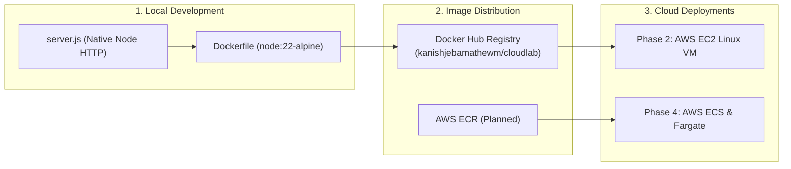

# CloudLab – A Hands-on Docker and AWS Learning Lab

[](https://hub.docker.com/repository/docker/kanishjebamathewm/cloudlab/general)
[](https://nodejs.org/)
[](https://alpinelinux.org/)

---

## 🎯 Project Overview & Purpose

**CloudLab** is a hands-on, practical DevOps learning repository. Its primary mission is to explore and master **containerisation, image distribution, infrastructure automation, and cloud deployments on Amazon Web Services (AWS)** using real-world engineering workflows.

> [!IMPORTANT]
> **Educational Scope**: CloudLab is **not** a commercial product and is not intended to solve an end-user business problem. The application is intentionally designed with zero external third-party dependencies so you can focus entirely on infrastructure, runtime internals, networking, security, and cloud architecture.

---

## 🏗️ Architecture & Technology Stack



- **Runtime**: Node.js (Standard Library `http` module only — zero npm dependencies).
- **Base Image**: `node:22-alpine` (~56MB minimal Linux container).
- **Container Security**: Least-privilege unprivileged user execution (`USER node`, UID 1000).
- **Distribution**: Docker Hub ([kanishjebamathewm/cloudlab](https://hub.docker.com/repository/docker/kanishjebamathewm/cloudlab/general)).
- **Cloud Infrastructure**: Amazon Web Services (AWS EC2, ECR, ECS Fargate, CloudWatch, S3, Terraform) progressively introduced.

---

## 🌐 The Application Endpoints

The HTTP server binds to `0.0.0.0` and listens on port `3000` by default (configurable via `PORT` environment variable):

| Endpoint | HTTP Method | Response Type | Description |
| :--- | :---: | :---: | :--- |
| `/` | `GET` | `text/html` | Minimal responsive welcome and architecture page |
| `/health` | `GET` | `application/json` | Health status, current timestamp, and container uptime |
| *Any other* | *Any* | `text/plain` | Returns HTTP `404 Not Found` |

### Sample `/health` Response:
```json
{
  "status": "ok",
  "timestamp": "2026-11-09T09:38:21.766Z",
  "uptime": 46
}
```

---

## 🚀 Getting Started Locally

### Option 1: Running with Node.js Directly
If Node.js is installed on your workstation:
```bash
# 1. Start the server
node server.js

# 2. Test the endpoints
curl http://localhost:3000/
curl http://localhost:3000/health
```

---

### Option 2: Running with Docker (Local Build)
Build and run the containerized application locally:

```bash
# 1. Build the lightweight image
docker build -t cloudlab:v1 .

# 2. Run the container in detached mode on port 3000
docker run -d -p 3000:3000 --name cloudlab-container cloudlab:v1

# 3. View container logs
docker logs cloudlab-container

# 4. Test endpoints in browser or terminal
curl http://localhost:3000/health

# 5. Stop and remove container when done
docker stop cloudlab-container
docker rm cloudlab-container
```

---

### Option 3: Pulling Directly from Docker Hub
You don't even need the source code! If Docker is installed:
```bash
docker run -d -p 3000:3000 --name cloudlab kanishjebamathewm/cloudlab:latest
```

---

## 📖 Comprehensive Learning Journal (`notes/`)

Every step, command output, bug, and design decision is documented in our structured lab notebook:

- 🗺️ **[Long-term Curriculum Roadmap](notes/ROADMAP.md)**
- 📁 **[Phase 1: Docker Fundamentals](notes/phase-1-docker/README.md)**
  1. [Why Docker? Environment Drift & VM Comparison](notes/phase-1-docker/01-why-docker.md)
  2. [Docker Architecture: CLI, Engine, Daemon & WSL2](notes/phase-1-docker/02-docker-architecture.md)
  3. [Images vs Containers: Blueprints vs Living Instances](notes/phase-1-docker/03-images-vs-containers.md)
  4. [Dockerfile Explained: Line-by-Line Security Analysis](notes/phase-1-docker/04-dockerfile-explained.md)
  5. [Building Images & Layers: BuildKit, Caching & Manifests](notes/phase-1-docker/05-building-images-and-layers.md)
  6. [Running Containers: Daemon Mode, Naming & Ports](notes/phase-1-docker/06-running-containers.md)
  7. [Ports & Networking: 0.0.0.0, Bridge Gateways & Port Mapping](notes/phase-1-docker/07-ports-and-networking.md)
  8. [Container Inspection: Extracting Low-Level JSON Metadata](notes/phase-1-docker/08-container-inspection.md)
  9. [Entering Containers: Shell Access, Users & Process IDs](notes/phase-1-docker/09-entering-containers.md)
  10. [Container Lifecycle: States & Diagnosing Exit Code 137](notes/phase-1-docker/10-container-lifecycle.md)
  11. [Docker Hub & Registries: Publishing & Image Digests](notes/phase-1-docker/11-docker-hub-and-registries.md)
  12. [Image Versioning & Rollback: Semantic Tags & `:latest`](notes/phase-1-docker/12-image-versioning-and-rollback.md)
  13. [Pulls, Pushes & Traffic: Web Visitors vs Image Pulls](notes/phase-1-docker/13-pulls-pushes-and-downloads.md)
  14. [GitHub vs Docker Hub: Source Code vs Binary Artifacts](notes/phase-1-docker/14-github-vs-docker-hub.md)
  15. [Docker Commands Cheatsheet: Task-Based CLI Reference](notes/phase-1-docker/15-docker-commands-cheatsheet.md)
  16. [Troubleshooting Guide: Real Failure Modes & Fixes](notes/phase-1-docker/16-troubleshooting.md)
  17. [Quiz & Practical Lab Exercises](notes/phase-1-docker/17-quiz-and-exercises.md)
- 📁 **[Phase 2: Deploying to AWS EC2](notes/phase-2-aws-ec2/README.md)** *(Planned)*

---

## 📊 Current Project Progress

- [x] **Phase 1: Docker Fundamentals** — *Completed & Documented*
- [ ] **Phase 2: AWS EC2 Cloud VM Deployment** — *Planned (Next Up)*
- [ ] **Phase 3: AWS Elastic Container Registry (ECR)** — *Planned*
- [ ] **Phase 4: AWS ECS & Serverless Fargate** — *Planned*
- [ ] **Phase 5: Amazon CloudWatch Observability** — *Planned*
- [ ] **Phase 6: AWS S3 Object Storage** — *Planned*
- [ ] **Phase 7: CI/CD Automation & Terraform IaC** — *Planned*
