# CloudLab Engineering Notes & Lab Journal

Welcome to the **CloudLab** engineering journal. This directory contains detailed, step-by-step practical notes, architecture diagrams, command outputs, debugging logs, and conceptual breakdowns created while learning containerisation and cloud deployment from first principles.

---

## 🎯 Purpose of this Journal

Rather than presenting dry, abstract definitions, every note in this directory documents:
- **What we did**: The exact commands executed in our real-world terminal.
- **Why we did it**: The architectural reasoning and operational principles behind each decision.
- **What happened**: Genuine command outputs, runtime configurations, and system metrics.
- **What broke**: Errors encountered (such as stopped daemons, port conflicts, and user permission limits) and how they were diagnosed.
- **What we learned & Try it yourself**: Core takeaways and guided exercises to reproduce every experiment.

---

## 🧭 Directory Map

```text
notes/
├── README.md                          <-- You are here
├── ROADMAP.md                         <-- Long-term curriculum from Docker to AWS Production
│
├── phase-1-docker/                    <-- Phase 1: Container Fundamentals (Completed)
│   ├── README.md                      <-- Phase 1 overview and syllabus
│   ├── 01-why-docker.md               <-- The problem of environment drift & VM comparison
│   ├── 02-docker-architecture.md      <-- CLI vs Engine, Docker Desktop & WSL2 internals
│   ├── 03-images-vs-containers.md     <-- Blueprints vs running instances
│   ├── 04-dockerfile-explained.md     <-- Deep-dive into each line of our Dockerfile
│   ├── 05-building-images-and-layers. <-- BuildKit, caching, digests & attestations
│   ├── 06-running-containers.md       <-- Daemon mode, naming, and port forwarding
│   ├── 07-ports-and-networking.md     <-- 0.0.0.0, localhost, bridge networks & ports
│   ├── 08-container-inspection.md     <-- JSON metadata analysis of running containers
│   ├── 09-entering-containers.md      <-- Shell access, process IDs & runtime users
│   ├── 10-container-lifecycle.md      <-- Created, Running, Stopped, and Exit Code 137
│   ├── 11-docker-hub-and-registries.  <-- Publishing to public registry & image manifests
│   ├── 12-image-versioning-and-rollba <-- Semantic tags, latest misconception & rollback
│   ├── 13-pulls-pushes-and-downloads. <-- Pulls vs HTTP traffic & caching mechanics
│   ├── 14-github-vs-docker-hub.md     <-- Source control vs artifact distribution
│   ├── 15-docker-commands-cheatsheet. <-- Comprehensive task-based CLI reference
│   ├── 16-troubleshooting.md          <-- Real failure modes encountered and fixes
│   └── 17-quiz-and-exercises.md       <-- Knowledge assessment with full answer key
│
└── phase-2-aws-ec2/                   <-- Phase 2: Deploying to AWS EC2 (Next Up)
    └── README.md                      <-- Cloud server architecture & syllabus
```

---

## 🚀 Learning Path & Methodology

```mermaid
flowchart LR
    A["Phase 1: Docker (Local)"] --> B["Phase 2: AWS EC2 (Single VM)"]
    B --> C["Phase 3: AWS ECR (Private Registry)"]
    C --> D["Phase 4: ECS & Fargate (Serverless Containers)"]
    D --> E["Phase 5: CloudWatch (Observability)"]
    E --> F["Phase 6: AWS S3 (Storage)"]
    F --> G["Phase 7: CI/CD & Terraform (Automation)"]

    style A fill:#0284c7,stroke:#0369a1,color:#fff
    style B fill:#e0f2fe,stroke:#0284c7,color:#0369a1
    style C fill:#e0f2fe,stroke:#0284c7,color:#0369a1
    style D fill:#e0f2fe,stroke:#0284c7,color:#0369a1
    style E fill:#e0f2fe,stroke:#0284c7,color:#0369a1
    style F fill:#e0f2fe,stroke:#0284c7,color:#0369a1
    style G fill:#e0f2fe,stroke:#0284c7,color:#0369a1
```



1. **Phase 1: Docker Fundamentals** *(Completed)*:
   Containerise a pure Node.js HTTP microservice, build optimized Alpine images, run non-root containers, debug networking, and distribute artifacts via Docker Hub.
2. **Phase 2: AWS EC2 Deployment** *(Next Up)*:
   Provision a Linux EC2 instance on AWS, configure security groups and SSH access, install Docker in the cloud, pull our published image, and serve traffic over the public internet.
3. **Phases 3–7**: Progressive advancement through enterprise container registries (ECR), container orchestration (ECS & AWS Fargate), logging/monitoring (CloudWatch), object storage (S3), and automated deployment pipelines (GitHub Actions & Terraform).

---

> [!NOTE]
> CloudLab is purely an educational project. The code is kept intentionally lean and dependency-free so you can focus entirely on understanding DevOps, container runtimes, and cloud architecture.
