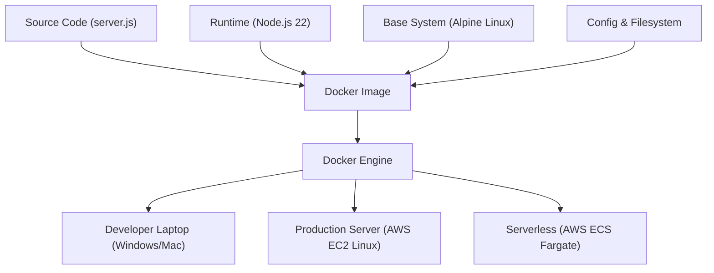

# Lesson 01: Why Docker?

## 1. The Classic Problem: "It Works on My Machine!"
In traditional software development, developers frequently encounter the frustrating scenario where code runs perfectly on their local laptop but crashes when deployed to a server or run on a teammate's computer.

### Why Does This Happen?
1. **Operating System Inconsistencies**: Paths, file separators (`/` vs `\`), environment variables, and filesystem case-sensitivity differ between Windows, macOS, and Linux.
2. **Runtime & Language Discrepancies**: The developer might have Node.js `v23.7.0` installed locally, while the production server runs Node.js `v18.16.0` with different engine capabilities and deprecated APIs.
3. **Missing System Libraries**: A binary dependency (like `libssl`, `glibc`, or image processing libraries) exists on one machine but is missing or an incompatible version on another.
4. **Configuration Drift**: Port collisions, permissions, and background services differ across machines.

---

## 2. What is Containerisation and What Does Docker Solve?
**Containerisation** is an operating-system-level virtualization method used to package an application along with all of its code, runtime environment, system tools, libraries, and configurations into a single standardized, self-contained unit called a **container**.

**Docker** is the platform and tooling that makes creating, running, and sharing containers fast, standardized, and repeatable.



### The CloudLab Concrete Example:
In our CloudLab environment:
- The **host machine** (Windows 11) runs:
  ```powershell
  node --version
  # Output: v23.7.0
  ```
- The **Docker container** runs:
  ```bash
  node --version
  # Output: v22.23.4
  ```

Because our CloudLab container packages its own Node.js v22 runtime on top of Alpine Linux, the application executes identically regardless of whether the host has Node.js 23, Node.js 16, or no Node.js installed at all!

---

## 3. Docker Containers vs. Virtual Machines (VMs)
A common beginner misconception is that Docker containers are just small virtual machines. They are architecturally very different:

```mermaid
flowchart TD
    subgraph VM_Arch["Virtual Machines Architecture"]
        AppA["App A"] --> GuestOSA["Guest OS (Full Linux/Win)"]
        GuestOSA --> Hypervisor["Hypervisor (Type 1 or 2)"]
        Hypervisor --> HostOS1["Host Operating System"]
        HostOS1 --> Hardware1["Physical Server Hardware"]
    end

    subgraph Container_Arch["Docker Container Architecture"]
        AppB["App 1"] --> Binaries["Libs & Node Runtime"]
        Binaries --> DockerEngine["Docker Engine"]
        DockerEngine --> SharedKernel["Host Linux Kernel"]
        SharedKernel --> Hardware2["Physical Server Hardware"]
    end
```



| Feature | Virtual Machine (VM) | Docker Container |
| :--- | :--- | :--- |
| **Architecture** | Emulates entire hardware stack + runs a full **Guest OS** | Runs directly on the host, sharing the **host kernel** |
| **Isolation Level** | Hypervisor-level hardware isolation (Strict) | Kernel namespaces & cgroups (Process-level isolation) |
| **Startup Time** | Minutes (boots full operating system kernel) | Milliseconds to seconds (starts a standard process) |
| **Disk Size** | Gigabytes to tens of gigabytes per VM | Megabytes (e.g., our `node:22-alpine` image is ~56MB) |
| **Resource Usage** | Pre-allocates fixed CPU and RAM | Dynamic, consumes only what the application process requires |

---

## 4. Why Docker is Essential for Backend Applications
- **Standardized Microservices**: Every service in a microservice ecosystem (APIs, caching layers, background workers) can have independent runtime versions without conflicting.
- **Simplified Onboarding**: A new engineer can clone the repository and run `docker run` to get started immediately, without spending days configuring local software versions.
- **Zero-Drift Deployments**: The exact image tested in development is what gets deployed to AWS EC2 or ECS.

### What Docker is NOT:
Docker is **not** a distribution channel for consumer mobile applications.
- Users do not download Android APKs or iOS apps from Docker Hub. Mobile apps are compiled native binaries distributed through app stores (Google Play, Apple App Store).
- Docker is designed for **server-side software, backend microservices, APIs, database instances, and DevOps pipelines**.

---

## 5. The Purpose of CloudLab
**CloudLab** is a focused educational project. 
- It is **not** intended to solve a commercial or user-facing business problem.
- It provides a minimal, dependency-free Node.js HTTP server as a clean canvas to master infrastructure concepts: Docker building, network routing, container lifecycle management, cloud provisioning on AWS EC2, and automated CI/CD.

---

## 💡 What We Learned
1. Environment drift between machines is the root cause of "works on my machine" failures.
2. Containers bundle the application code and runtime dependencies together while sharing the host OS kernel.
3. Containers are lightweight processes, unlike Virtual Machines which emulate hardware and boot complete guest operating systems.
4. Container runtimes allow a host machine (running Node v23) to run containers with entirely different runtime versions (Node v22) cleanly.

---

## 🛠️ Try It Yourself
1. Verify the Node.js version installed on your host system:
   ```bash
   node --version
   ```
2. If you have Docker installed, run a one-off container with a completely different Node.js version and check its internal runtime:
   ```bash
   docker run --rm node:18-alpine node --version
   ```
3. Notice how Docker downloads the image and prints `v18.x.x` without changing anything on your host machine!
