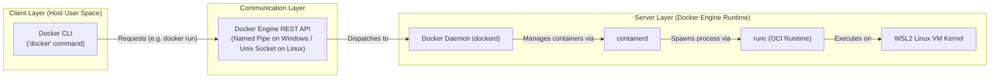

# Lesson 02: Docker Architecture & Windows/WSL2 Internals

## 1. The Core Components of Docker
Docker is not a single monolithic program. It is built as a client-server architecture consisting of distinct layers:



### Component Breakdown:
1. **Docker CLI (`docker`)**: The command-line interface that developers interact with. It does not run containers itself; it translates user commands into REST API calls.
2. **Docker REST API**: The HTTP/JSON API used by the CLI (and external tools) to communicate with the Docker daemon.
3. **Docker Daemon (`dockerd`)**: The background process responsible for building images, running containers, configuring virtual networks, and managing volumes.
4. **Docker Desktop**: An application for Windows and macOS that bundles the Docker CLI, Docker Engine, Docker Compose, Kubernetes, and a lightweight Linux VM (using WSL2 on Windows) into an integrated desktop interface.
5. **WSL2 (Windows Subsystem for Linux 2)**: The Windows virtualization feature that provides a genuine Linux kernel so Docker can run real Linux containers on Windows.
6. **Docker Contexts**: Mechanisms allowing a single Docker CLI to switch between different Docker daemon endpoints (e.g., local `desktop-linux` vs remote AWS/SSH daemons).

---

## 2. What Happens When You Run `docker info`?
The `docker info` command queries both the local client and the connected Docker Engine, outputting system-wide information separated into two primary sections: **Client** and **Server**.

### Our Actual Initial Failure Mode:
During our CloudLab setup, running `docker info` initially returned an error:

```text
Client:
 Version:    29.4.0
 Context:    desktop-linux
 Debug Mode: false
 ...

Server:
failed to connect to the docker API at npipe:////./pipe/dockerDesktopLinuxEngine; 
check if the path is correct and if the daemon is running: 
open //./pipe/dockerDesktopLinuxEngine: The system cannot find the file specified.
```

### Why Did This Happen?
- The **Docker CLI** was installed and functional on Windows.
- However, **Docker Desktop had not been started yet**, which meant the background Linux engine in WSL2 was powered off.
- The Windows named pipe `\\.\pipe\dockerDesktopLinuxEngine` did not exist because the daemon was not listening.

> [!IMPORTANT]
> **Key Insight**: Installing the Docker CLI (`docker.exe`) only gives you the command-line client. Containers cannot build or run until the **Docker Engine daemon** is running in the background!

---

## 3. The Working Environment: Successful `docker info`
Once Docker Desktop was launched and its WSL2 engine initialized, running `docker info` completed with exit code 0:

```text
Client:
 Version:    29.4.0
 Context:    desktop-linux

Server:
 Containers: 0 (Running: 0, Paused: 0, Stopped: 0)
 Images: 4
 Server Version: 29.4.0
 Storage Driver: overlayfs
 Operating System: Docker Desktop (containerized)
 Kernel Version: 6.18.54.1-microsoft-standard-WSL2
 Architecture: x86_64
 CPUs: 4
 Total Memory: 3.784GiB
```

### Analysis of the Observed Metrics:
- **`Context: desktop-linux`**: Confirms the CLI is talking to the local Docker Desktop Linux VM rather than a remote cloud host.
- **`Kernel Version: 6.18.54.1-microsoft-standard-WSL2`**: Linux kernel version running inside Windows via WSL2.
- **`Storage Driver: overlayfs`**: The Linux filesystem driver used to combine image layers into a unified container view.
- **`CPUs: 4` & `Memory: 3.784GiB`**: The compute resources allocated from Windows to the Docker WSL2 utility VM.

---

## 💡 What We Learned
1. The Docker CLI and Docker Engine are separate entities connected by an API.
2. The CLI can exist and execute without the Engine, but container operations (`build`, `run`, `ps`) require an active Engine.
3. On Windows, Docker relies on WSL2 to provide the native Linux kernel needed to instantiate Linux containers.
4. An error referencing `dockerDesktopLinuxEngine` simply means Docker Desktop is closed or starting up.

---

## 🛠️ Try It Yourself
1. Run `docker info` and locate the `Client:` and `Server:` headings.
2. Note your current context:
   ```bash
   docker context show
   # Expected output: desktop-linux
   ```
3. Check the allocated memory and CPU limits available to your containers:
   ```bash
   docker info --format 'CPUs: {{.NCPU}}, Memory: {{.MemTotal}}'
   ```
