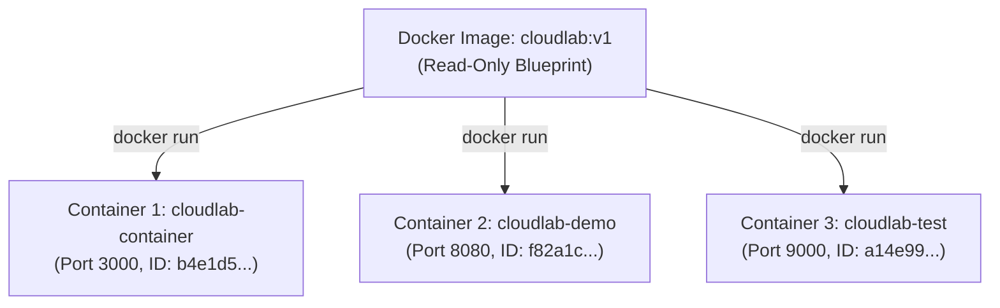

# Lesson 03: Images versus Containers

## 1. The Fundamental Distinction
One of the most frequent points of confusion for beginners is the difference between an **image** and a **container**.

The simplest analogy is from Object-Oriented Programming (OOP) or architecture:

| Concept | OOP Analogy | Architecture Analogy | Docker Equivalent |
| :--- | :--- | :--- | :--- |
| **Blueprint / Class** | `class CloudLabServer` | Architectural Blueprints | **Docker Image** |
| **Instance / Object** | `const lab1 = new CloudLabServer()` | Actual Physical House | **Docker Container** |



---

## 2. Definitions: Image, Container, Repository, and Registry

### What is an Image?
- An **image** is an **immutable (read-only)**, packaged snapshot that contains everything needed to run an application: operating system libraries, the runtime (Node.js), application code (`server.js`), and default startup commands.
- Images are stored locally in the Docker cache and have unique cryptographic hash IDs (e.g., `sha256:54c43e03...`).
- Images **never change once built**. If you change a line of code, you build a new image.

### What is a Container?
- A **container** is a **runnable, living instance** of an image.
- When you execute `docker run`, Docker takes the read-only image layers and adds a thin **read-write layer** on top (known as the *container layer*).
- Multiple independent containers can be spawned from the exact same image simultaneously.

### What is a Repository & Registry?
- **Repository**: A collection of related images with the same name but different tags (e.g., `kanishjebamathewm/cloudlab:v1` and `kanishjebamathewm/cloudlab:latest`).
- **Registry**: A hosted service that stores and distributes repositories (e.g., **Docker Hub**, **AWS ECR**, or GitHub Container Registry).

---

## 3. Why Containers and Images Exist Independently
1. **Multiple Containers from One Image**:
   You can run `cloudlab:v1` on port 3000 as `cloudlab-container` and also on port 8080 as `cloudlab-demo`. Both share the underlying image layers on disk, saving storage space.
2. **Deleting a Container Does NOT Delete the Image**:
   Running `docker rm cloudlab-container` destroys the running process and its thin read-write layer, but `cloudlab:v1` remains safely stored in your local image cache.
3. **Images Exist Without Containers**:
   You can have 50 images downloaded on your machine while `docker ps -a` shows 0 containers.

---

## 4. Comparing CLI Commands: `docker images` vs `docker ps` vs `docker ps -a`

In our CloudLab session, we executed each of these commands:

### A. `docker images`
Lists the read-only images stored on your local disk:
```text
IMAGE                      ID             DISK USAGE   CONTENT SIZE
cloudlab:v1                54c43e038c69        180MB         56.2MB
node:22-alpine             0e1754758c2d        180MB         56.2MB
```

### B. `docker ps`
Lists **only currently running** containers:
```text
CONTAINER ID   IMAGE         COMMAND                  STATUS          PORTS                    NAMES
b4e1d56101b8   cloudlab:v1   "docker-entrypoint.s…"   Up 12 minutes   0.0.0.0:3000->3000/tcp   cloudlab-container
```

### C. `docker ps -a`
Lists **all containers**, including those that are stopped or exited:
```text
CONTAINER ID   IMAGE         COMMAND                  STATUS                        NAMES
b4e1d56101b8   cloudlab:v1   "docker-entrypoint.s…"   Exited (137) 2 minutes ago    cloudlab-container
```

---

## 5. Immutable Image IDs vs. Mutable Tags
In Docker, image identification has two levels:

1. **Image Digest / ID (Immutable)**:
   A SHA-256 cryptographic hash representing the exact bit-for-bit content of the image:
   ```text
   sha256:54c43e038c6926df45fc4658a059c89dd39b5a02bdb4baf896d3a11cf1ad89e7
   ```
   If a single character in `server.js` changes, the resulting digest changes completely.

2. **Tags (Mutable)**:
   Human-readable aliases or pointers that can be reassigned:
   ```text
   cloudlab:v1
   cloudlab:latest
   ```
   Just like a Git branch (`main`) points to a specific commit hash, a Docker tag (`latest`) is simply a label pointing to an underlying image digest. You can point `latest` to a new digest whenever you release an update.

---

## 💡 What We Learned
1. An image is a read-only blueprint; a container is an isolated running instance with a thin writable layer.
2. A single image can spawn many isolated containers concurrently.
3. `docker images` inspects your disk cache of blueprints; `docker ps` inspects living processes.
4. Tags are mutable human labels; cryptographic image digests are permanent and tamper-proof.

---

## 🛠️ Try It Yourself
1. List all images stored on your system:
   ```bash
   docker images
   ```
2. Spawn two separate containers from the same image on different host ports:
   ```bash
   docker run -d --name lab-one -p 3001:3000 cloudlab:v1
   docker run -d --name lab-two -p 3002:3000 cloudlab:v1
   ```
3. Run `docker ps` to verify both are running side-by-side using the same base image!
4. Clean them up:
   ```bash
   docker stop lab-one lab-two
   docker rm lab-one lab-two
   ```
