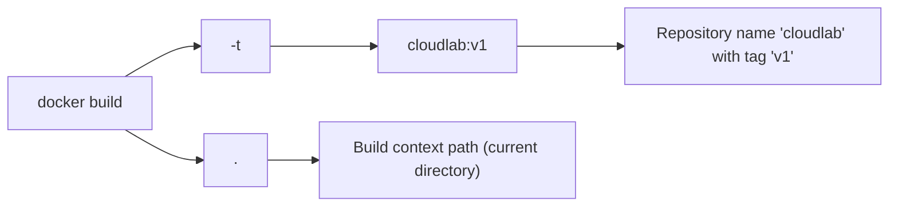
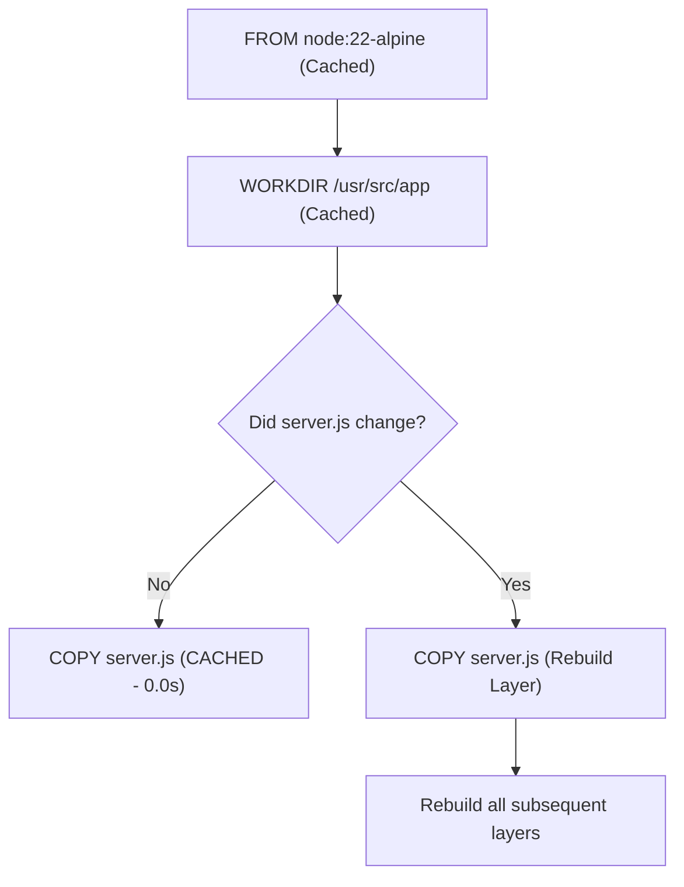

# Lesson 05: Building Images, Layers, and BuildKit Internals

## 1. Anatomy of the Build Command
To turn our Dockerfile into an executable container image, we ran:

```bash
docker build -t cloudlab:v1 .
```



### Command Component Analysis:
- **`docker build`**: Instructs Docker Engine to build an image from a Dockerfile.
- **`-t cloudlab:v1`**: The "tag" flag assigns a human-readable repository name (`cloudlab`) and version tag (`v1`). If you omit the `:tag`, Docker defaults to `:latest`.
- **`.` (Current Directory)**: Specifies the **build context**. The Docker CLI bundles everything in this directory and transmits it to the Docker Engine daemon to start the build.

---

## 2. The Build Context and `.dockerignore`
When `docker build` executes, the CLI does not read files directly on your disk; it creates an archive of the directory specified by the context (`.`) and streams it to the Docker daemon.

### Why `.dockerignore` is Critical:
Without a [.dockerignore](file:///c:/Users/Admin/Desktop/aws-docker/.dockerignore) file, large and unnecessary files (such as local `.git` history, temporary logs, and local `node_modules`) are sent across the daemon boundary, slowing down builds and potentially exposing sensitive files in the image layers.

In CloudLab, our `.dockerignore` excludes:
```text
.git
.dockerignore
node_modules
npm-debug.log
README.md
```
During our build, we observed:
```text
#4 [internal] load .dockerignore
#4 transferring context: 96B done
#5 [internal] load build context
#5 transferring context: 2.08kB done
```
Because of `.dockerignore`, our build context transfer was a tiny **2.08 kB**!

---

## 3. Real Build Output Analysis: Build Stages & Layers
Here is the actual step-by-step output captured during the build of `cloudlab:v1`:

```text
#0 building with "desktop-linux" instance using docker driver
#1 [internal] load build definition from Dockerfile
#2 [internal] load metadata for docker.io/library/node:22-alpine
#6 [1/3] FROM docker.io/library/node:22-alpine@sha256:0e1754758c...
#6 sha256:881fc932939e 3.85MB / 3.85MB done
#6 sha256:2a9491572f6e 56.22MB / 56.22MB done
#6 extracting sha256:2a9491572f6e 9.2s done
#7 [2/3] WORKDIR /usr/src/app
#8 [3/3] COPY --chown=node:node server.js .
#9 exporting to image
#9 naming to docker.io/library/cloudlab:v1
```

### The Three Execution Stages:
1. **`[1/3] FROM node:22-alpine`**: Downloads and extracts the Alpine Linux root filesystem and the Node.js binaries.
2. **`[2/3] WORKDIR /usr/src/app`**: Updates container execution metadata to set the default directory.
3. **`[3/3] COPY --chown=node:node server.js .`**: Injects `server.js` and updates filesystem file metadata.

---

## 4. Layer Caching Mechanics
Docker caches the output of every instruction. If you build the image a second time without modifying `server.js`, Docker uses the cached layers:



Because `server.js` is copied last, changes to application code do not invalidate the base image download or directory creation steps.

---

## 5. Modern Image Artifacts: Manifests, Digests, Indexes & Attestations
During step `#9 exporting to image`, our build generated:
```text
#9 exporting manifest sha256:bd2a98c3e55f15...
#9 exporting config sha256:08dda3f245...
#9 exporting attestation manifest sha256:1420f7c9c3...
#9 exporting manifest list sha256:54c43e038c...
```

### Understanding What These Mean:
1. **Image Config**: A JSON file describing environment variables, working directory, architecture (`amd64`), and entrypoint command.
2. **Image Manifest**: A JSON specification linking the image configuration to its constituent filesystem layer hashes.
3. **Image Index (Manifest List)**: A wrapper allowing multiple architectures (e.g., `linux/amd64` for Intel/AMD and `linux/arm64` for Apple Silicon) to be published under a single tag (`cloudlab:v1`).
4. **Build Attestation**: Metadata automatically attached by modern Docker BuildKit recording build provenance (how the image was created) and SBOM (Software Bill of Materials) for supply chain security.

---

## 💡 What We Learned
1. The `.` at the end of `docker build` defines the build context transferred to the daemon.
2. A proper `.dockerignore` keeps build contexts tiny and prevents accidental secret leaks.
3. Layer caching accelerates iterative development by skipping unchanged steps.
4. Modern Docker builds produce attestations and multi-platform manifest lists alongside raw container layers.

---

## 🛠️ Try It Yourself
1. Build the image with a custom tag:
   ```bash
   docker build -t cloudlab:dev .
   ```
2. Run the build again immediately and observe `CACHED` markers:
   ```bash
   docker build -t cloudlab:dev .
   ```
3. Inspect the image history and see the layer breakdown:
   ```bash
   docker history cloudlab:dev
   ```
