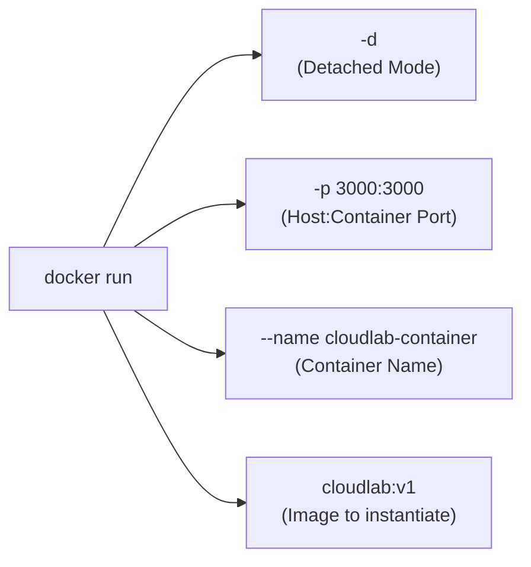
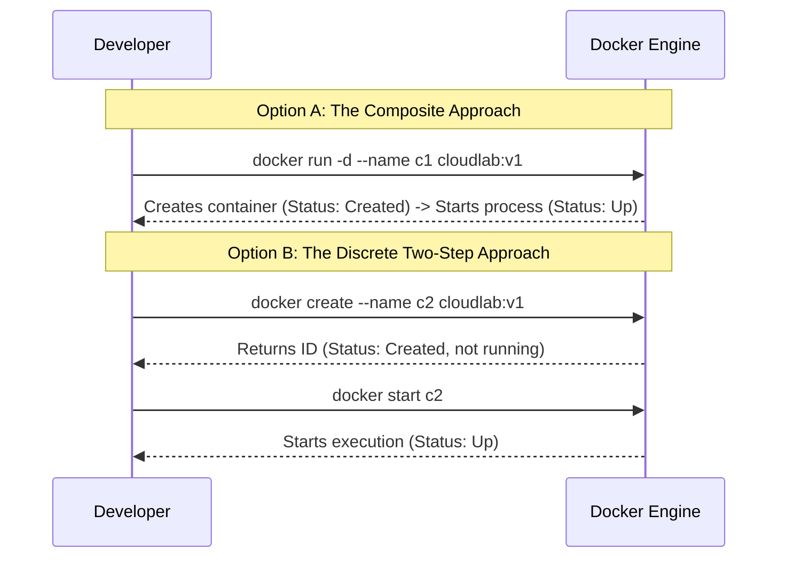

# Lesson 06: Running Containers

## 1. Anatomy of the `docker run` Command
To instantiate a living container from our `cloudlab:v1` image, we executed:

```bash
docker run -d -p 3000:3000 --name cloudlab-container cloudlab:v1
```



### Detailed Breakdown of Flags:
- **`docker run`**: The atomic command that creates a writable container layer over the specified image and immediately starts it.
- **`-d` (Detached Mode)**:
  - Runs the container as a background daemon process.
  - Releases your terminal prompt immediately and outputs the full 64-character container ID (e.g., `b4e1d56101b868fe0ef33f8db08ccf8e2bacd1627360fe6cdc1c15f4c968affb`).
  - Without `-d`, the container runs in the **foreground**, streaming standard output directly into your terminal and blocking further input.
- **`-p 3000:3000` (Port Publishing)**:
  - Bridges network traffic from **Host Port 3000** to **Container Port 3000** (`HOST_PORT:CONTAINER_PORT`).
- **`--name cloudlab-container`**:
  - Assigns an explicit, human-readable name to the container instance.
  - If omitted, Docker assigns an auto-generated random name like `peaceful_curie` or `nervous_pasteur`.
- **`cloudlab:v1`**:
  - Specifies the local or remote image to instantiate.

---

## 2. Under the Hood: `docker run` vs `docker create` + `docker start`
It is essential to understand that `docker run` is a composite convenience command combining two separate lifecycle steps:



1. **`docker create`**: Prepares the container's isolated filesystem, assigns namespaces, sets up networking, and returns a container ID without starting the process.
2. **`docker start`**: Boots the configured `CMD` process inside the prepared environment.

---

## 3. Our Observed Container
Upon executing the run command, Docker reported the container ID:
```text
b4e1d56101b868fe0ef33f8db08ccf8e2bacd1627360fe6cdc1c15f4c968affb
```

Checking with `docker ps` verified its active state:
```text
CONTAINER ID   IMAGE         COMMAND                  STATUS         PORTS                    NAMES
b4e1d56101b8   cloudlab:v1   "docker-entrypoint.s…"   Up 5 minutes   0.0.0.0:3000->3000/tcp   cloudlab-container
```

And viewing the container logs confirmed the internal Node.js server had started:
```bash
docker logs cloudlab-container
# Output:
# CloudLab server is listening on http://0.0.0.0:3000
```

---

## 💡 What We Learned
1. `docker run` creates and boots a container in a single unified command.
2. The `-d` flag runs the container in the background, keeping your shell interactive.
3. `--name` gives containers predictable, human-friendly identifiers.
4. Container logs capture the application's stdout/stderr even when running in detached mode.

---

## 🛠️ Try It Yourself
1. Run a container in the foreground to observe how it captures the terminal:
   ```bash
   docker run --rm -p 8080:3000 cloudlab:v1
   ```
   *(Press `Ctrl + C` to stop it).*
2. Run it in the background using detached mode:
   ```bash
   docker run -d --name background-lab -p 8080:3000 cloudlab:v1
   ```
3. Check the logs of the background container:
   ```bash
   docker logs background-lab
   ```
4. Stop and remove the test container:
   ```bash
   docker stop background-lab && docker rm background-lab
   ```
