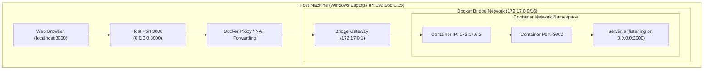

# Lesson 07: Ports, Networking, and Address Binding

## 1. Network Namespaces: Host vs. Container
One of the most powerful features of containerisation is **network namespace isolation**. 

A container has its own private virtual network stack:
- Its own loopback interface (`lo`).
- Its own virtual ethernet interface (`eth0`).
- Its own private IP address (in our lab: `172.17.0.2`).
- Its own routing table, firewall rules, and port space (ports 1–65535).



---

## 2. Port Forwarding Syntax: `HOST_PORT:CONTAINER_PORT`
When you specify `-p`, the syntax follows a strict convention:

$$\text{-p } \mathbf{HOST\_PORT} : \mathbf{CONTAINER\_PORT}$$

### Comparing Scenarios:
1. **`-p 3000:3000` (Our CloudLab Setup)**:
   - Traffic arriving at host port `3000` is forwarded into container port `3000`.
   - Accessible on the host at `http://localhost:3000`.
2. **`-p 8080:3000`**:
   - The application inside the container still listens on port `3000`.
   - But users access it on the host via `http://localhost:8080`!
   - This proves that the external port does **not** have to match the internal port.

---

## 3. The Port Conflict Experiment: Local Node vs Docker Container
In our session, we conducted a real-world port collision experiment:

1. We initially started the server directly on the Windows host:
   ```bash
   node server.js
   # Bound host port 3000 on Windows
   ```
2. When we subsequently attempted to run Docker with `-p 3000:3000`, the host port `3000` was already occupied!
3. **Why this happened**:
   - While the container has its own private port 3000, publishing (`-p 3000:...`) requires the Docker daemon to bind port 3000 on the **host network interface**.
   - Two distinct programs on the same operating system cannot bind to the exact same host IP and port combination simultaneously.
4. **The Solution**:
   - We stopped the local Windows Node process, freeing up host port `3000`, allowing Docker to bind it cleanly.

---

## 4. `0.0.0.0` vs. `127.0.0.1` vs. `localhost`

Understanding IP addresses is critical for backend engineers:

| Address | Formal Name | Meaning & Behavior |
| :--- | :--- | :--- |
| **`0.0.0.0`** | INADDR_ANY | **"Listen on all network interfaces."** Inside a container, binding to `0.0.0.0` tells the server to accept connections from both the internal loopback and the external Docker bridge interface (`eth0`). |
| **`127.0.0.1`** | Loopback / Localhost | **"This machine only."** Traffic never leaves the local network adapter. |
| **`localhost`** | Hostname | A domain name that resolves to `127.0.0.1` (IPv4) or `::1` (IPv6). |

### Common Beginner Pitfalls:
> [!CAUTION]
> **Pitfall 1: Binding to `127.0.0.1` inside `server.js`**
> If your server code binds to `127.0.0.1` inside a container (`server.listen(3000, '127.0.0.1')`), the application will **only** accept requests coming from inside that container itself. Requests forwarded from your host via the Docker bridge network will be rejected! **Always bind to `0.0.0.0` inside containerized servers.**

> [!WARNING]
> **Pitfall 2: Typing `http://0.0.0.0:3000` into your browser**
> `0.0.0.0` is an instruction for servers to bind to all interfaces; it is **not a valid destination IP** for browser requests. Always use `http://localhost:3000` or `http://127.0.0.1:3000` in your browser.

---

## 5. Security Best Practice: Restricting Host Bindings
By default, `-p 3000:3000` binds to `0.0.0.0:3000` on your host, which means anyone on your local Wi-Fi network who knows your computer's IP address could potentially access your container.

For private local development, you can bind explicitly to host localhost:
```bash
docker run -d -p 127.0.0.1:8080:3000 --name private-lab cloudlab:v1
```
This guarantees that only your machine can send requests to port 8080.

---

## 💡 What We Learned
1. Containers have their own private network namespace, gateway, and IP address.
2. Port forwarding syntax is `HOST_PORT:CONTAINER_PORT`.
3. Servers inside containers must listen on `0.0.0.0` so bridge traffic can enter.
4. Two different services cannot simultaneously bind to the same host port.
5. `EXPOSE` in a Dockerfile does not publish ports; the runtime `-p` flag is required.

---

## 🛠️ Try It Yourself
1. Run CloudLab on an unconventional host port (e.g., 9090):
   ```bash
   docker run -d --name port-test -p 9090:3000 cloudlab:v1
   ```
2. Open your browser and visit:
   - `http://localhost:9090` -> Works!
   - `http://localhost:3000` -> Fails (port 3000 is not published)!
3. Inspect the port mappings of the running container:
   ```bash
   docker port port-test
   # Output: 3000/tcp -> 0.0.0.0:9090
   ```
4. Clean up:
   ```bash
   docker stop port-test && docker rm port-test
   ```
