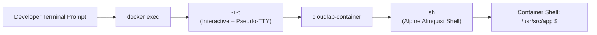
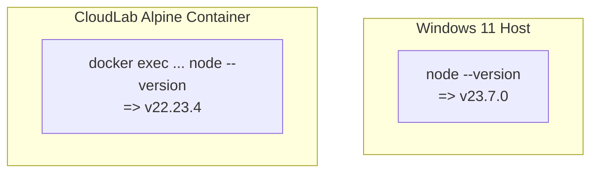

# Lesson 09: Entering Containers and Process Exploration

## 1. Entering a Running Container with `docker exec`
Once a container is running in detached mode, how do you inspect its active filesystem, processes, or environment variables? You use `docker exec`.

The standard command to spawn an interactive shell inside a running container is:

```bash
docker exec -it cloudlab-container sh
```



### Deconstructing the Command:
- **`docker exec`**: Spawns an additional process inside an already running container namespace.
- **`-i` (Interactive)**: Keeps standard input (`STDIN`) open so you can type commands.
- **`-t` (TTY)**: Allocates a pseudo-terminal screen, providing terminal formatting, color output, and keyboard signal handling.
- **`sh` vs `bash`**:
  - In standard Ubuntu or Debian containers, developers often use `bash`.
  - In **Alpine Linux**, `bash` is not installed by default to keep the base image under 5MB. Alpine provides `sh` (powered by BusyBox), which is extremely lightweight and POSIX-compliant.

---

## 2. Our Real-World Shell Observations
In our session, we inspected the internal environment non-interactively using:
```bash
docker exec cloudlab-container sh -c "id; pwd; ls -la"
```

Here is the exact terminal output captured:
```text
uid=1000(node) gid=1000(node) groups=1000(node)
/usr/src/app
total 12
drwxr-xr-x    1 root     root          4096 Nov  9 09:55 .
drwxr-xr-x    1 root     root          4096 Nov  9 09:55 ..
-rwxr-xr-x    1 node     node          2041 Nov  9 09:30 server.js
```

---

## 3. Dissecting the Findings

### A. Process Identity: `uid=1000(node)`
Running `id` or `whoami` verified:
- **Process User**: `node` (UID `1000`)
- **Process Group**: `node` (GID `1000`)
This proves that our application is running without root privileges, adhering strictly to container security best practices.

### B. Filesystem Ownership: File vs Directory Ownership
Notice the subtle permission detail in `ls -la`:
- The working directory `/usr/src/app` (`.`) is owned by `root:root`.
  - **Reason**: The directory was created during the `WORKDIR /usr/src/app` instruction in the Dockerfile before the `USER node` switch occurred.
- The application file `server.js` is owned by `node:node`.
  - **Reason**: Our instruction explicitly specified `--chown=node:node`:
    ```dockerfile
    COPY --chown=node:node server.js .
    ```
- This means the unprivileged `node` user can read and execute `server.js`, but cannot arbitrarily alter parent system directories.

---

## 4. Host Node.js vs Container Node.js
We executed `node --version` in both environments:



### Why Do They Differ?
1. The Windows host has Node.js **v23.7.0** installed directly in Windows Program Files.
2. The Docker container executes Node.js **v22.23.4**, which is baked into the `node:22-alpine` image layers.
3. The containerized application ignores the host's Node installation completely. When the base image maintainers publish security patches for the Node 22 LTS branch, the container patch version will update accordingly.

---

## 💡 What We Learned
1. `docker exec -it <container> sh` allows you to jump into a running Alpine container.
2. Alpine Linux uses `sh` instead of `bash`.
3. Process ownership (`node` UID 1000) and file ownership (`COPY --chown`) were verified live.
4. Host runtime versions and container runtime versions are completely isolated from each other.

---

## 🛠️ Try It Yourself
1. If your container is running, execute a one-off command without opening an interactive shell:
   ```bash
   docker exec cloudlab-container uname -a
   # Shows the Linux kernel version running inside WSL2
   ```
2. Check the memory usage of the containerized Node process:
   ```bash
   docker exec cloudlab-container ps aux
   ```
3. Type `exit` whenever you exit an interactive shell session.
