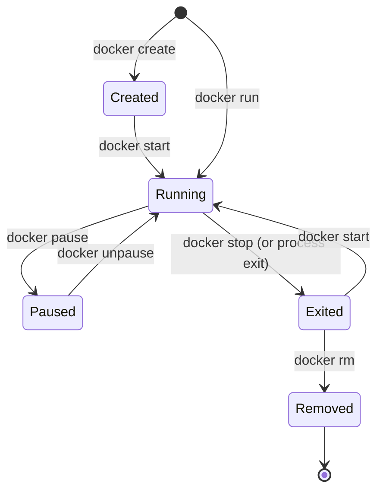

# Lesson 10: Container Lifecycle & The Exit Code 137 Mystery

## 1. The Container Lifecycle State Machine
A container is not a permanent machine; it is an ephemeral lifecycle of distinct operational states:



### State Definitions:
1. **Created**: The container's network and filesystem layers are initialized on disk, but the application process has not started.
2. **Running**: The primary process (`PID 1`) is executing actively.
3. **Paused**: All processes in the container are temporarily suspended using Linux cgroups freezer without terminating the process.
4. **Exited (Stopped)**: The primary process has terminated. The container's writable layer and logs remain intact on disk.
5. **Restarting**: The container crashed or exited, and Docker is automatically rebooting it according to its configured `RestartPolicy`.
6. **Removed**: The container metadata and writable filesystem layer are deleted from disk.

---

## 2. Our Real Lifecycle Experiment: Stopping CloudLab
During our hands-on session, we executed:

```bash
docker stop cloudlab-container
```

Next, checking with `docker ps` returned an empty table:
```text
CONTAINER ID   IMAGE     COMMAND   CREATED   STATUS    PORTS     NAMES
```
The container cleanly disappeared from the list of running processes.

Next, checking with `docker ps -a` (all containers) revealed:
```text
CONTAINER ID   IMAGE         COMMAND                  STATUS                        NAMES
b4e1d56101b8   cloudlab:v1   "docker-entrypoint.s…"   Exited (137) 27 seconds ago   cloudlab-container
```

---

## 3. Investigating Exit Code 137
Why did `docker stop` result in **`Exited (137)`** instead of `0`?

In Linux systems, an exit code greater than 128 indicates that the process was terminated by an operating system signal:

$$\text{Exit Code} = 128 + \text{Signal Number}$$

Since signal number 9 is **`SIGKILL`** (forced termination):

$$128 + 9 = 137$$

### How `docker stop` Operates:
1. **Step 1: Graceful Shutdown (`SIGTERM`)**:
   Docker sends `SIGTERM` to the container's PID 1, asking the application to cleanly finish existing HTTP requests, close open sockets/database connections, and exit with code 0.
2. **Step 2: Grace Period**:
   Docker waits for a configured grace period (default: 10 seconds).
3. **Step 3: Force Kill (`SIGKILL`)**:
   If the process has not terminated after the grace period expires, Docker sends `SIGKILL` (signal 9), immediately killing the process and producing exit code 137.

### Why Did CloudLab Exit with 137?
In our container inspection, we noticed:
```json
"StopTimeout": 1
```
The base image or engine had configured a short 1-second timeout. Additionally, our minimal `server.js` did not register explicit signal listeners:
```javascript
// A production graceful shutdown listener looks like this:
process.on('SIGTERM', () => {
  server.close(() => {
    process.exit(0);
  });
});
```
Because the Node HTTP server did not immediately intercept and cleanly exit upon receiving `SIGTERM`, Docker sent `SIGKILL` after the 1-second timeout elapsed.

> [!NOTE]
> Not all `docker stop` commands produce exit code 137. If your application handles `SIGTERM` gracefully within the grace period, it will exit with code 0.

---

## 4. `docker start` vs `docker run`
When a container is in the `Exited` state:
- You do **not** run `docker run` again unless you want to create a brand-new, duplicate container.
- You run **`docker start cloudlab-container`** to resume execution of the existing stopped container.
- **Important**: `docker start` does **not** rebuild the image or pull changes from your code editor. It boots the existing container layer that was created previously.

---

## 5. Cleaning Up with `docker rm`
To permanently remove a stopped container:
```bash
docker rm cloudlab-container
```
- This frees up the container ID and removes the container's private writable layer.
- The underlying image (`cloudlab:v1`) remains safely cached on disk.

---

## 💡 What We Learned
1. Stopping a container (`docker stop`) preserves its filesystem and state in `docker ps -a`.
2. Exit code 137 represents termination by `SIGKILL` ($128 + 9$).
3. Applications need to register `SIGTERM` handlers to achieve graceful zero-exit shutdowns.
4. `docker start` resumes an existing stopped container, while `docker run` creates a new instance.
5. Removing a container (`docker rm`) does not delete the parent image.

---

## 🛠️ Try It Yourself
1. Restart the stopped container:
   ```bash
   docker start cloudlab-container
   ```
2. Verify it is running again with `docker ps`.
3. Stop it once more and remove it completely:
   ```bash
   docker stop cloudlab-container
   docker rm cloudlab-container
   ```
4. Verify with `docker ps -a` that it is completely gone.
