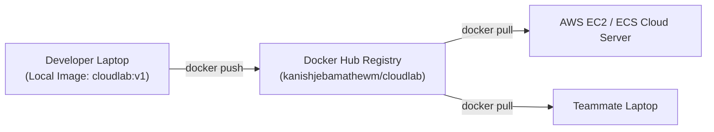
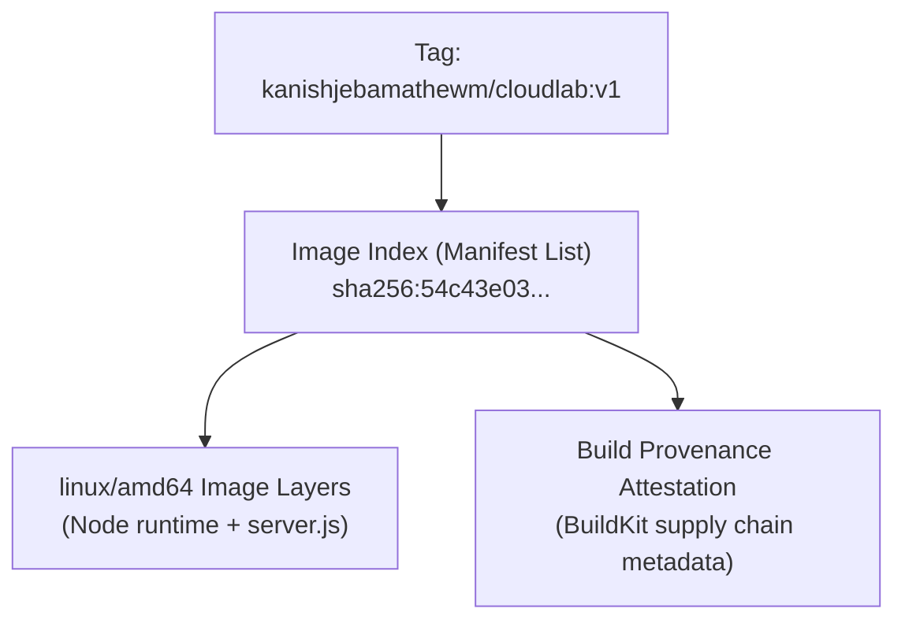

# Lesson 11: Docker Hub, Registries, and Image Distribution

## 1. What is Docker Hub and a Container Registry?
Building an image locally is only the first step. To deploy an image to a cloud server (like AWS EC2) or share it with teammates, you must publish it to a **Container Registry**.

- **Container Registry**: A centralized, network-accessible storage and content delivery system for container images (similar to npm for JavaScript packages or PyPI for Python packages).
- **Docker Hub**: The default public container registry maintained by Docker Inc.



---

## 2. Our Real Docker Hub Repository & Publication
In our session, we published our image to:
- **Registry URL**: [https://hub.docker.com/repository/docker/kanishjebamathewm/cloudlab/general](https://hub.docker.com/repository/docker/kanishjebamathewm/cloudlab/general)
- **Repository**: `kanishjebamathewm/cloudlab`

### The Publishing Workflow:
1. **Authentication**:
   ```bash
   docker login
   ```
   Authenticates the local Docker CLI with Docker Hub credentials and stores a secure credential token.
2. **Tagging for Remote Registry**:
   Docker determines where to push an image by parsing its name:
   $$\mathbf{registry.domain} / \mathbf{username} / \mathbf{repository} : \mathbf{tag}$$
   *(If the registry domain is omitted, Docker defaults to `docker.io` = Docker Hub).*
   ```bash
   docker tag cloudlab:v1 kanishjebamathewm/cloudlab:v1
   docker tag cloudlab:v1 kanishjebamathewm/cloudlab:latest
   ```
3. **Pushing the Image**:
   ```bash
   docker push kanishjebamathewm/cloudlab:v1
   docker push kanishjebamathewm/cloudlab:latest
   ```

Both tags were published with the exact same content digest:
```text
v1: digest: sha256:54c43e038c6926df45fc4658a059c89dd39b5a02bdb4baf896d3a11cf1ad89e7 size: 856
latest: digest: sha256:54c43e038c6926df45fc4658a059c89dd39b5a02bdb4baf896d3a11cf1ad89e7 size: 856
```

---

## 3. Dissecting Docker Hub Artifacts: Image Index, OS Layer, and Attestations
When inspecting a tag in Docker Hub, beginners are often surprised to see multiple entries associated with a single tag. 

In our CloudLab release, Docker Hub listed:
1. **An Image Index (Manifest List)**: A top-level metadata document that acts as a router.
2. **A `linux/amd64` Image**: The actual compiled container filesystem for 64-bit x86 architecture.
3. **An Attestation**: Cryptographic build provenance metadata generated automatically by BuildKit.



> [!IMPORTANT]
> **Crucial Beginner Clarifications:**
> - These three items are **not** three separate running applications!
> - These are **not** three separate GitHub commits!
> - They are the individual metadata components that make up a modern OCI-compliant container artifact.
> - In Docker Hub, the status **"Active"** simply means the artifact exists and is ready for download in the registry; it does **not** mean a container is currently running or consuming CPU in the cloud!

---

## 4. Anyone Can Run It Anywhere
Because CloudLab is published publicly, any developer or server worldwide with Docker installed can run our application without cloning the repository or installing Node.js:

```bash
docker run -d -p 3000:3000 --name cloudlab kanishjebamathewm/cloudlab:latest
```

The Docker Engine automatically pulls the required layers, instantiates the container, and serves the application on port 3000!

---

## 💡 What We Learned
1. Docker Hub serves as a central registry for distributing packaged container images.
2. Image names prefixed with `username/repo` map directly to Docker Hub accounts.
3. Tags like `:v1` and `:latest` can point to the exact same underlying image digest.
4. "Active" in Docker Hub indicates repository presence, not container execution.

---

## 🛠️ Try It Yourself
1. Inspect the tags and digests of your local images:
   ```bash
   docker images kanishjebamathewm/cloudlab
   ```
2. Pull the image explicitly from the remote registry:
   ```bash
   docker pull kanishjebamathewm/cloudlab:latest
   ```
