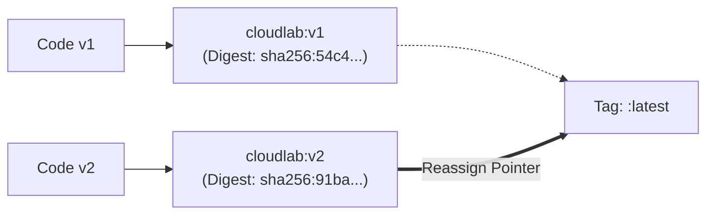

# Lesson 12: Image Versioning, the `:latest` Myth, and Instant Rollbacks

## 1. The Strategy of Semantic Versioning for Containers
In production environments, deploying unversioned code is dangerous. Container registries use tags to track versions and enable reproducible deployments.



---

## 2. The Great `:latest` Misconception
Many beginners believe that the `:latest` tag possesses magical properties:
- **Myth 1**: "Docker automatically creates and updates `:latest` whenever you build an image."
  - **Reality**: Docker only tags an image as `:latest` if you omit the tag flag entirely (e.g. `docker build -t cloudlab .`). If you run `docker build -t cloudlab:v2 .`, Docker will **not** update `:latest` unless you explicitly tell it to!
- **Myth 2**: "When I push a new `:latest` image to Docker Hub, running containers will automatically update."
  - **Reality**: Running containers are completely isolated and frozen in memory. They will never pull or switch images on their own. You must stop the old container, pull the new image, and run a new container.
- **Myth 3**: "Always deploy using `:latest` in production."
  - **Reality**: In enterprise production, using `:latest` is considered an anti-pattern. Because `:latest` is mutable (it can point to a new image tomorrow), deployments become non-deterministic. Production teams always deploy explicit immutable tags (e.g., `:v1.2.4` or Git commit SHAs `:git-a1b2c3d`).

---

## 3. How to Release a New Version (`v2`)
Suppose we enhance CloudLab's `server.js` with a new feature. Here is the standard release workflow:

```bash
# 1. Build the new version
docker build -t kanishjebamathewm/cloudlab:v2 .

# 2. Re-point the 'latest' alias to v2
docker tag kanishjebamathewm/cloudlab:v2 kanishjebamathewm/cloudlab:latest

# 3. Publish both tags to Docker Hub
docker push kanishjebamathewm/cloudlab:v2
docker push kanishjebamathewm/cloudlab:latest
```

---

## 4. Running Two Versions Simultaneously
Because containers isolate port spaces, you can run multiple versions of CloudLab on a single host side-by-side:

```bash
# Run v1 on host port 3001
docker run -d --name cloudlab-v1 -p 3001:3000 kanishjebamathewm/cloudlab:v1

# Run v2 on host port 3002
docker run -d --name cloudlab-v2 -p 3002:3000 kanishjebamathewm/cloudlab:v2
```

This capability powers modern deployment techniques such as **A/B Testing** and **Canary Deployments**.

---

## 5. Instant Rollback in Case of Bugs
Imagine you deploy `cloudlab:v2` to production on port 3000, but discover a critical bug. 

With traditional server configurations, rolling back can take hours of dependency reinstallation. With Docker, rollback is nearly instantaneous:

```bash
# 1. Stop the failing v2 container (5 seconds)
docker stop cloudlab-production
docker rm cloudlab-production

# 2. Start the known-good v1 container from the local cache (1 second!)
docker run -d --name cloudlab-production -p 3000:3000 kanishjebamathewm/cloudlab:v1
```

Because `cloudlab:v1` is already cached locally on the host, the rollback completes in seconds without downloading anything from the internet!

---

## 💡 What We Learned
1. Container tags are mutable labels pointing to immutable SHA-256 digests.
2. `:latest` does not update automatically and does not push updates to running containers.
3. Deploying explicit version tags (`:v1`, `:v2`) ensures reproducible, audit-proof infrastructure.
4. Containerization enables instant rollbacks because previous image versions remain cached locally.

---

## 🛠️ Try It Yourself
1. Tag your existing local `cloudlab:v1` image as a test release:
   ```bash
   docker tag cloudlab:v1 cloudlab:test-tag
   ```
2. Verify both tags appear in `docker images` sharing the same `IMAGE ID`:
   ```bash
   docker images cloudlab
   ```
3. Remove the test tag without deleting the underlying image:
   ```bash
   docker rmi cloudlab:test-tag
   ```
