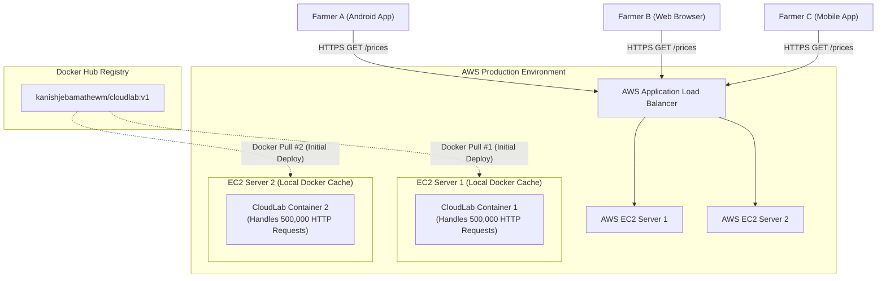

# Lesson 13: Pulls, Pushes, Network Traffic, and the FarmiGo Analogy

## 1. The Big Question: Do 1,000,000 Users Mean 1,000,000 Docker Pulls?
During our engineering discussions, we explored a fundamental architectural question:
> *"If our application gets 1,000,000 active website visitors, does Docker Hub experience 1,000,000 image pulls?"*

The answer is an emphatic **NO**.

Beginners frequently confuse **client network requests** with **infrastructure container downloads**. Understanding the separation between runtime HTTP traffic and build-time artifact distribution is essential for DevOps engineers.

---

## 2. The FarmiGo Practical Example
Consider an agricultural platform like **FarmiGo** where farmers check crop prices using a mobile application:



### Traffic Analysis:
1. **End-User Traffic**: 1,000,000 farmers send lightweight HTTP requests over the internet to the AWS Load Balancer.
2. **Container Execution**: Two long-running Docker containers on AWS EC2 process all 1,000,000 requests in memory.
3. **Docker Hub Pulls**: Exactly **2 pulls** occurred! Each EC2 server pulled the image once when starting up, cached it locally, and continuously served incoming HTTP traffic.

---

## 3. Dissecting the Categories of Network Activity

| Category | Protocol | Source | Destination | Frequency |
| :--- | :--- | :--- | :--- | :--- |
| **Mobile App Download** | HTTPS | Smartphone | Google Play / Apple App Store | Once per app installation or update |
| **HTTP Request** | HTTP/S | User browser or mobile client | Cloud Load Balancer / Container port 3000 | Millions of times daily per user interaction |
| **Docker Image Pull** | HTTPS (OCI) | Cloud Host / Server / CI runner | Docker Hub / AWS ECR | Once per server boot, deployment, or auto-scale event |

---

## 4. Why Docker Hub Pull Counts Do NOT Equal Unique Users
When visiting our public repository on Docker Hub, we observed a pull counter:
```text
47 Pulls
```

Does this mean 47 unique people deployed or used CloudLab? **No.**
- Automated security scanning bots constantly crawl public Docker Hub repositories.
- CI/CD pipelines (like GitHub Actions) pull images on every commit test run.
- A single developer testing local deployments across different terminals can trigger 10 pulls in an hour.
- A single server that restarts without a persistent layer cache pulls the image again.

---

## 5. Caching Behaviour: Traditional VMs vs. AWS Fargate
- **Traditional EC2 Linux Servers**:
  When you pull an image onto an EC2 virtual machine, Docker saves the layers in `/var/lib/docker/`. Restarting the container or spinning up 10 more containers from that image pulls from the local disk cache—zero Docker Hub pulls!
- **Serverless AWS ECS Fargate**:
  Fargate is ephemeral; AWS provisions an isolated micro-VM for each container task on demand. When a new Fargate task boots, it pulls the container image. (AWS mitigates this by aggressively caching common upstream base images inside the AWS regional network).

> [!NOTE]
> **Docker Hub Pull Rate Limits**:
> Unauthenticated and free accounts on Docker Hub are subject to rate limiting policies (e.g., number of pulls per 6-hour window). For production workloads, engineering teams either upgrade their plans or mirror images into private, high-throughput cloud registries like **AWS ECR**. Always consult current official Docker documentation for up-to-date pricing and rate limit policies.

---

## 💡 What We Learned
1. End-user HTTP requests are served by running containers; they do not trigger Docker image pulls.
2. An application can handle millions of web visitors with only a handful of image pulls.
3. Docker Hub pull counters reflect artifact downloads by machines, CI systems, and bots—not unique human visitors.
4. Local image layer caching prevents redundant network downloads.

---

## 🛠️ Try It Yourself
1. Pull your published image from Docker Hub:
   ```bash
   docker pull kanishjebamathewm/cloudlab:v1
   ```
2. Run it again immediately:
   ```bash
   docker pull kanishjebamathewm/cloudlab:v1
   # Notice: "Image is up to date" - zero layers downloaded!
   ```
