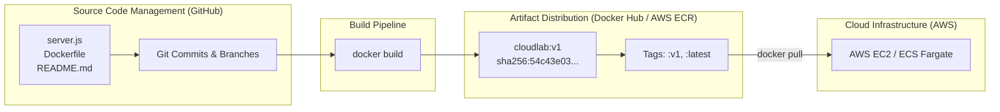

# Lesson 14: GitHub vs. Docker Hub — Source Code vs. Artifacts

## 1. Why Do We Need Both?
A fundamental milestone in learning DevOps is recognizing the distinction between **source code version control** and **compiled container artifact distribution**.

Engineers use **GitHub** and **Docker Hub** in tandem because they serve two completely different stages of the software delivery lifecycle:



---

## 2. Feature Comparison Matrix

| Feature | GitHub | Docker Hub |
| :--- | :--- | :--- |
| **Primary Artifact** | Human-readable source code (`.js`, `.py`, `.md`) | Binary container images (compiled filesystem layers) |
| **Storage Unit** | Git repository & commits | OCI image repositories & layer blobs |
| **Versioning Scheme** | Git Commit SHAs (`git commit`), branches, tags | Image tags (`:v1`, `:latest`) & manifest digests |
| **Who Reads It?** | Software developers, code review peers | Docker Engine, AWS EC2, Kubernetes, ECS |
| **Diff Capability** | Shows exact line-by-line code changes (`git diff`) | Cannot show code diffs; stores compiled filesystem blobs |
| **Execution** | Cannot run applications directly | Can instantiate living containers anywhere in seconds |
| **Security Scanning** | Code scanning, static analysis (SAST) | Container vulnerability scanning (CVEs in OS packages) |

---

## 3. The Modern Deployment Pipeline
Notice the flow from left to right:
1. **GitHub**: You write code, test it locally, and commit your changes (`git push origin main`).
2. **Build Automation**: A CI server (like GitHub Actions) checks out your source code and executes `docker build`.
3. **Registry Storage**: The resulting container image is pushed to a container registry (**Docker Hub** or **AWS ECR**).
4. **Cloud Execution**: The production cloud server (AWS EC2 or ECS) pulls the binary image from the registry and runs it.

> [!NOTE]
> In enterprise AWS environments (which we will explore in Phase 3), companies often replace Docker Hub with **AWS ECR (Elastic Container Registry)**. ECR is hosted inside AWS data centers, offering faster pull times to EC2 instances, lower data transfer costs, and direct integration with AWS IAM security roles.

---

## 💡 What We Learned
1. GitHub manages source code, developer collaboration, and Git commit history.
2. Docker Hub stores pre-built binary container images ready for immediate execution.
3. Docker Hub does not track line-by-line source code history; it tracks image digests and tags.
4. AWS ECR provides an AWS-native alternative to Docker Hub for enterprise deployments.

---

## 🛠️ Try It Yourself
1. Review your local Git status:
   ```bash
   git status
   ```
2. Review your local Docker image cache:
   ```bash
   docker images
   ```
3. Notice how `git` tracks file modifications while `docker` tracks assembled container layers.
