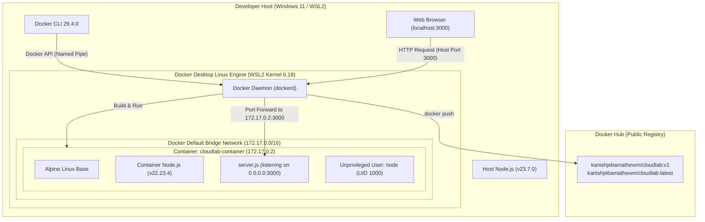

# Phase 1: Docker Fundamentals & Container Architecture

Welcome to **Phase 1** of CloudLab. This module documents the essential foundations of containerisation using Docker. All lessons are grounded in practical experiments conducted on the CloudLab application.

---

## 📑 Syllabus & Lesson Index

| # | Lesson Title | Key Concepts & Experiments Covered |
| :---: | :--- | :--- |
| **01** | [Why Docker?](01-why-docker.md) | "Works on my machine" problem, environment drift, VMs vs containers, kernel sharing |
| **02** | [Docker Architecture](02-docker-architecture.md) | Docker CLI, Engine daemon, Docker Desktop, WSL2 Linux backend, diagnosing offline engines |
| **03** | [Images vs Containers](03-images-vs-containers.md) | Immutable blueprints vs running instances, IDs vs tags, storage layers |
| **04** | [Dockerfile Explained](04-dockerfile-explained.md) | Line-by-line breakdown of `FROM`, `WORKDIR`, `COPY --chown`, `USER`, `EXPOSE`, `CMD` |
| **05** | [Building Images & Layers](05-building-images-and-layers.md) | BuildKit, caching mechanisms, `.dockerignore`, image manifests, indexes, and attestations |
| **06** | [Running Containers](06-running-containers.md) | Foreground vs detached (`-d`) execution, container naming (`--name`), port mapping flags |
| **07** | [Ports & Networking](07-ports-and-networking.md) | Host ports vs container ports (`-p 3000:3000`), `0.0.0.0` vs `127.0.0.1`, bridge networks |
| **08** | [Container Inspection](08-container-inspection.md) | Analyzing `docker inspect` JSON output: PID, network gateway, IP, and state |
| **09** | [Entering Containers](09-entering-containers.md) | Interactive TTY sessions (`docker exec -it ... sh`), verifying UID 1000 (`node`), Node versions |
| **10** | [Container Lifecycle](10-container-lifecycle.md) | Created, Running, Paused, Exited states; analyzing `Exit Code 137` and stop signals |
| **11** | [Docker Hub & Registries](11-docker-hub-and-registries.md) | Public registries, image push/pull, multi-platform image manifests, and attestations |
| **12** | [Image Versioning & Rollback](12-image-versioning-and-rollback.md) | Semantic tagging (`v1`, `v2`), the `:latest` misconception, zero-downtime rollback strategies |
| **13** | [Pulls, Pushes & Traffic](13-pulls-pushes-and-downloads.md) | Docker pulls vs HTTP web requests, image layer caching, FarmiGo user traffic analogy |
| **14** | [GitHub vs Docker Hub](14-github-vs-docker-hub.md) | Source code version control vs binary artifact distribution, role of AWS ECR |
| **15** | [Docker Commands Cheatsheet](15-docker-commands-cheatsheet.md) | Comprehensive task-based quick-reference CLI guide with real CloudLab examples |
| **16** | [Troubleshooting Guide](16-troubleshooting.md) | Real errors encountered: daemon connection failures, port conflicts, 137 exits, permission issues |
| **17** | [Quiz & Practical Exercises](17-quiz-and-exercises.md) | 15 multiple-choice questions, scenario problems, and hands-on lab challenges with answer key |

---

## 🏗️ Phase 1 Architecture Overview

---

## 🏁 Recommended Reading Order
We recommend reading lessons **01 through 14** sequentially to follow the organic learning progression, and keeping **15 (Cheatsheet)** and **16 (Troubleshooting)** open as reference guides. Test your retention with **17 (Quiz & Exercises)** before moving on to Phase 2.
