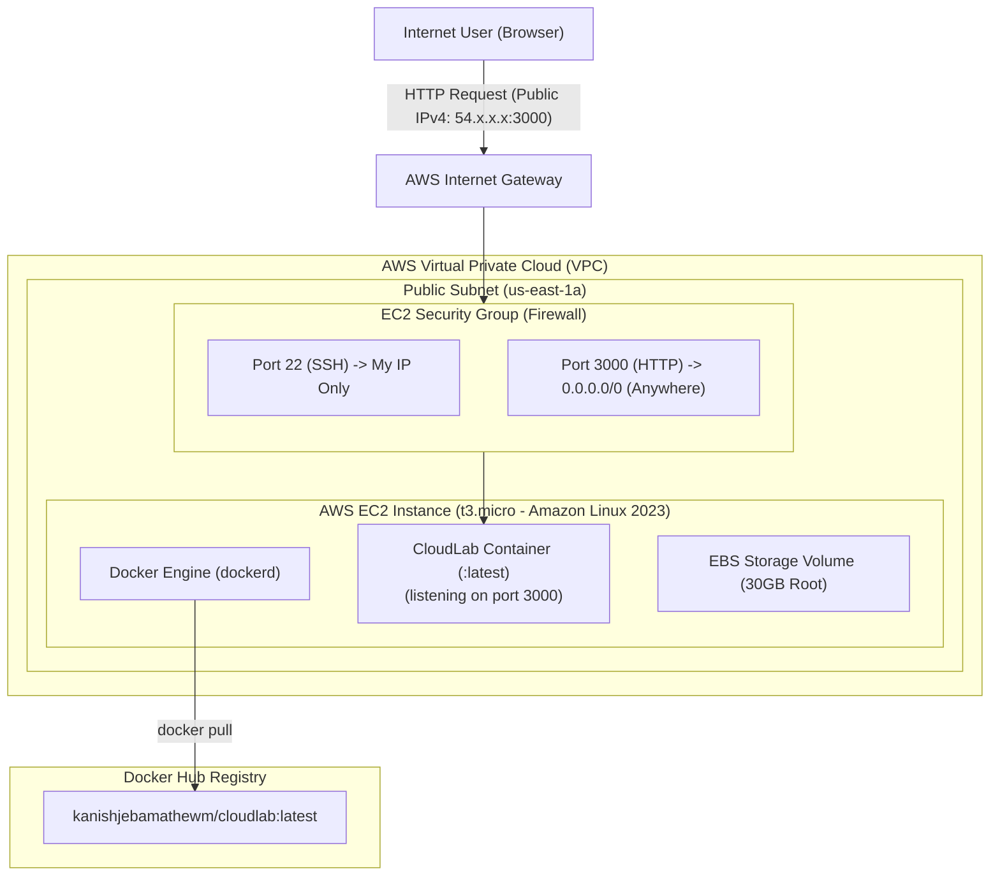

# Phase 2: Deploying CloudLab on AWS EC2

> [!NOTE]
> **Status: Planned (Next Phase)**
> Phase 2 takes our containerised application from local developer workstations into the public cloud using **Amazon Web Services (AWS)**.

---

## 🎯 Phase 2 Objectives
In Phase 1, we successfully containerised CloudLab and published its image to Docker Hub. In Phase 2, we will provision a live Linux server in the cloud, install Docker, pull our public image, and expose CloudLab to the world over the public internet.



---

## 📚 Topics & Curriculum

### 1. Cloud Infrastructure & Compute Basics
- What is **Amazon Elastic Compute Cloud (EC2)**?
- Understanding **Amazon Machine Images (AMIs)**: Amazon Linux 2023 vs. Ubuntu Server.
- Instance Types & Sizing: Exploring the AWS Free Tier with `t3.micro` / `t2.micro` (1 vCPU, 1 GiB RAM).

### 2. Networking & Cloud Security
- **Amazon VPC Basics**: Public subnets, Route Tables, and Internet Gateways (IGW).
- **Security Groups (Virtual Stateful Firewalls)**:
  - Ingress Rule 1: SSH (port 22) restricted strictly to your local IP address.
  - Ingress Rule 2: HTTP application traffic (port 3000 or port 80) allowed from anywhere (`0.0.0.0/0`).
- **Key Pairs & Asymmetric Cryptography**: Generating `.pem` private keys and setting strict permissions (`chmod 400 key.pem`).

### 3. Remote Host Configuration & Deployment
- Connecting securely via SSH:
  ```bash
  ssh -i "cloudlab-key.pem" ec2-user@<ec2-public-ipv4>
  ```
- Installing and enabling Docker Engine on Amazon Linux:
  ```bash
  sudo dnf update -y
  sudo dnf install -y docker
  sudo systemctl start docker
  sudo systemctl enable docker
  sudo usermod -aG docker ec2-user
  ```
- Pulling and running CloudLab in the cloud:
  ```bash
  docker run -d -p 3000:3000 --name cloudlab-cloud kanishjebamathewm/cloudlab:latest
  ```

### 4. Cloud Verification & Financial Hygiene
- Verifying the live endpoints over the public IPv4 address:
  - Welcome Page: `http://<ec2-public-ip>:3000/`
  - Health Endpoint: `http://<ec2-public-ip>:3000/health`
- **Cost Management**: Safely stopping or terminating EC2 instances when experiments conclude to prevent unexpected cloud charges.
